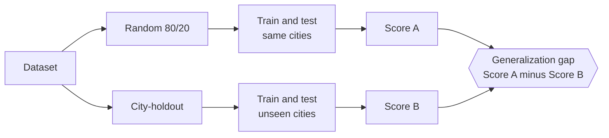
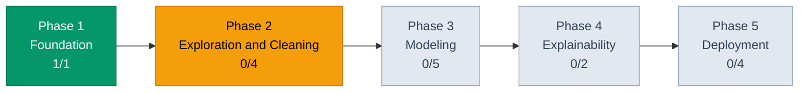

<div align="center">


<br/>


<br/>

[Overview](#-overview) · [Dataset](#-dataset) · [Methodology](#-methodology) · [Results](#-results) · [Tech Stack](#-tech-stack) · [Getting Started](#-getting-started) · [Roadmap](#-roadmap) · [Limitations](#-known-limitations)

</div>

---

## 🔎 Overview

An explainable machine-learning project on house prices across **60 Indian cities** and **31 states / UTs**. It asks two questions:

<table>
<tr>
<td width="50%" valign="top">

### 🌍 Does it generalize?

Most price models are tested on a random split, so the test cities were already seen during training. This project also holds out **entire cities** and compares the two scores.

</td>
<td width="50%" valign="top">

### 🧠 Can it explain itself?

A prediction is only useful if you can see why it was made. **SHAP** explains the model globally and per prediction, and a **Streamlit** app shows both.

</td>
</tr>
</table>

> [!NOTE]
> **Status:** work in progress. Step 1 (environment setup and dataset creation) is done; step 2 (EDA) is underway. See the [Roadmap](#-roadmap).

### 🎯 Objectives

- [ ] Explore and clean the dataset
- [ ] Compare a random 80/20 split against a city-holdout split
- [ ] Train and tune Linear Regression, Random Forest and XGBoost / Gradient Boosting
- [ ] Explain predictions with SHAP (global and per prediction)
- [ ] Ship a Streamlit app that shows a price and its explanation

---

## 📊 Dataset

> [!IMPORTANT]
> The dataset is **synthetic and generated programmatically**. It is *a synthetic dataset modeled on real-world housing market patterns*, not scraped listings or real transactions, so results describe how the method behaves, not the real Indian housing market.

### 📦 At a glance

<table align="center" width="100%">
<tr>
<th align="center" width="20%">📄 Rows</th>
<th align="center" width="20%">🧱 Columns</th>
<th align="center" width="20%">🏙️ Cities</th>
<th align="center" width="20%">🗺️ States / UTs</th>
<th align="center" width="20%">📅 Years</th>
</tr>
<tr>
<td align="center"><b>260,000</b></td>
<td align="center"><b>57</b></td>
<td align="center"><b>60</b></td>
<td align="center"><b>31</b></td>
<td align="center"><b>2022–2025</b></td>
</tr>
</table>

### 🏙️ City coverage

**City tiers:** 8 metro · 28 tier-2 · 24 tier-3

<table align="center" width="100%">
<tr>
<th align="center" width="30%">Tier</th>
<th align="center" width="20%">Cities</th>
<th align="center" width="50%">Share of the 60 cities</th>
</tr>
<tr>
<td align="center">🏙️ Metro</td>
<td align="center"><b>8</b></td>
<td align="center"><code>▓░░░░░░░░░</code> 13%</td>
</tr>
<tr>
<td align="center">🏢 Tier-2</td>
<td align="center"><b>28</b></td>
<td align="center"><code>▓▓▓▓▓░░░░░</code> 47%</td>
</tr>
<tr>
<td align="center">🏘️ Tier-3</td>
<td align="center"><b>24</b></td>
<td align="center"><code>▓▓▓▓░░░░░░</code> 40%</td>
</tr>
</table>

### 🗂️ Details

<table align="center" width="100%">
<tr>
<th align="center" width="30%">Item</th>
<th align="center" width="70%">Detail</th>
</tr>
<tr>
<td align="center">🎯 Targets</td>
<td align="center"><code>price_inr</code>, <code>price_per_sqft</code></td>
</tr>
<tr>
<td align="center">🧪 Source</td>
<td align="center">Synthetic, generated programmatically</td>
</tr>
<tr>
<td align="center">💾 Location</td>
<td align="center"><code>data/raw/</code>, tracked with Git LFS</td>
</tr>
<tr>
<td align="center">📝 Documentation</td>
<td align="center"><a href="data/raw/README.md"><code>data/raw/README.md</code></a> describes all 57 columns</td>
</tr>
</table>

---

## 🧪 Methodology

The project is a **six-stage pipeline**. The key design decision sits at **Stage 2 (Split)**, where the same data is split in two ways: a random 80/20 split and a city-holdout split. Every model is trained and scored on both, and the **generalization gap** between the two scores is the main finding.

### 🔁 Pipeline at a glance

<div align="center">


⬇

<table align="center">
<tr>
<td align="center"><br/><b>Prepare</b><br/><sub>EDA · clean · features</sub></td>
<td align="center">➜</td>
<td align="center"><br/><b>Split</b><br/><sub>random · city-holdout</sub></td>
<td align="center">➜</td>
<td align="center"><br/><b>Model</b><br/><sub>LR · RF · XGBoost</sub></td>
<td align="center">➜</td>
<td align="center"><br/><b>Evaluate</b><br/><sub>tune · score · gap</sub></td>
<td align="center">➜</td>
<td align="center"><br/><b>Explain</b><br/><sub>errors · SHAP</sub></td>
<td align="center">➜</td>
<td align="center"><br/><b>Deploy</b><br/><sub>save · app · test</sub></td>
</tr>
</table>

⬇


</div>

### 🏗️ Pipeline architecture

Every step of the pipeline and what each stage hands to the next one. Stages 3 and 4 run on **both** splits, so every model gets a Score A (random) and a Score B (city-holdout).

<div align="center">


⬇

</div>

| Stage | Steps | Hands off |
|:---|:---|:---|
| <br/>**Prepare** | `1.1` EDA<br/>`1.2` Data cleaning<br/>`1.3` Deeper EDA by city and tier<br/>`1.4` Feature engineering | ⬇ Clean, feature-engineered dataset |
| <br/>**Split** | `2.1` 🎲 **Path A:** random 80/20 split (test cities were seen in training)<br/>`2.2` 🏙️ **Path B:** city-holdout split (test cities are unseen) | ⬇ Two train / test sets: **Split A** and **Split B** |
| <br/>**Model** | `3.1` Linear Regression (baseline)<br/>`3.2` Random Forest<br/>`3.3` XGBoost / Gradient Boosting | ⬇ 6 fitted models (3 algorithms × 2 splits) |
| <br/>**Evaluate** | `4.1` Tune with `GroupKFold` by city<br/>`4.2` Score both splits (MAE, RMSE, R²)<br/>`4.3` Generalization gap = Score A − Score B | ⬇ Results table and the generalization gap |
| <br/>**Explain** | `5.1` Error analysis by city and tier<br/>`5.2` Global SHAP (which features matter overall)<br/>`5.3` Per-prediction SHAP (why this one price) | ⬇ Charts in `reports/charts/` |
| <br/>**Deploy** | `6.1` Save model and explainer<br/>`6.2` Build the Streamlit app<br/>`6.3` Deploy<br/>`6.4` Test end to end | 🏁 Live app showing a price and its explanation |

### ⚖️ Evaluation design



| | 🎲 Random 80/20 | 🏙️ City-holdout |
|:---|:---|:---|
| **Test rows come from** | Any city, shuffled | Cities never seen in training |
| **What it measures** | Fit to known cities | Transfer to new cities |
| **Question answered** | "Does it work on more of the same?" | "Does it work somewhere new?" |
| **Hypothesis** | Optimistic score | Lower, more realistic score |

> The hypothesis is untested until step 10. The size of the gap is the finding either way.

### 🛡️ Design rules

| # | Rule | Why |
|:---:|:---|:---|
| 1 | Exclude both targets (`price_inr`, `price_per_sqft`) from the features | Prevents target leakage |
| 2 | Fit scalers and encoders on the training set only | Test data must not influence preprocessing |
| 3 | Hold out cities across all three tiers (optionally leave one tier out) | The test must not favor one tier |
| 4 | Tune with `GroupKFold` grouped by city | Validation folds also contain unseen cities |
| 5 | Use the same split and seed for every model | Keeps the comparison fair |

---

## 📈 Results

> [!NOTE]
> Results will be filled in after step 10 (final evaluation). Nothing below has been measured yet.

| Model | R² (random) | MAE (random) | R² (city-holdout) | MAE (city-holdout) |
|:---|:---:|:---:|:---:|:---:|
| Linear Regression | – | – | – | – |
| Random Forest | – | – | – | – |
| XGBoost | – | – | – | – |

**Planned figures:** SHAP summary plot · error by city tier · Streamlit app screenshot

---

## 🧰 Tech Stack

| Layer | Tools | Role in this project |
|:---|:---|:---|
| **Language & env** |   | Python version pinned in `.python-version`, dependencies managed by uv |
| **Data handling** |   | Loading, cleaning and feature engineering |
| **Visualization** |   | EDA and result charts |
| **Modeling** |   | Linear Regression, Random Forest, XGBoost / Gradient Boosting, tuning |
| **Explainability** |  | Global and per-prediction explanations |
| **App** |  | Interactive price and explanation app |
| **Notebooks** |  | Exploration and experiments |
| **Versioning** |   | Source control and large dataset files |

---

## 📁 Project Structure

```text
📂 india-house-price-prediction
├── 📂 data
│   ├── 📂 raw            # original synthetic dataset + data dictionary
│   └── 📂 processed      # cleaned and feature-engineered data
├── 📂 notebooks          # EDA and experiments
├── 📂 src                # reusable pipeline code
├── 📂 models             # saved models and SHAP explainer
├── 📂 app                # Streamlit app
├── 📂 reports
│   ├── 📂 docs           # project plan and literature review
│   └── 📂 charts         # figures used in the report
├── 📄 .python-version    # pinned Python version
├── 📄 pyproject.toml     # project metadata and dependencies (uv)
├── 📄 uv.lock            # exact locked library versions (uv)
├── 📄 requirements.txt   # pip-compatible dependency list
└── 📄 README.md
```

---

## 🚀 Getting Started

<div align="center">


</div>

Setup usually takes a few minutes and has four steps: **get the code → set up the environment → verify → start exploring**. Steps 1 to 4 are fully visible. Only optional extras are folded away, and each one is labelled **"Click to expand"**.

### 📋 Prerequisites

| Tool | Why you need it | Check it is installed |
|:---|:---|:---|
| **Git** | Downloads (clones) the project | `git --version` |
| **Git LFS** | The large dataset file is stored with Git LFS, so without it you get a tiny placeholder instead of the data | `git lfs version` |
| **uv** (recommended) or **Python** | Creates the environment and installs the libraries | `uv --version` or `python --version` |

### 1️⃣ Get the code

```bash
# one-time setup per machine: lets Git handle large files
git lfs install

# download the project
git clone https://github.com/Suman-Acharyya/India_house_price_prediction.git

# move into the project folder (all later commands run from here)
cd India_house_price_prediction
```

| Command | What it does |
|:---|:---|
| `git lfs install` | Switches on Git LFS for your Git installation. You only need to do it once. |
| `git clone ...` | Copies the whole project to your computer. Because Git LFS is on, the large dataset is downloaded as well. |
| `cd ...` | Enters the project folder. Every command below must be run from inside it. |

> [!TIP]
> If the dataset file in `data/raw/` is only a few lines of text, the LFS download did not happen. Run `git lfs pull` inside the project folder to fetch the real file.

### 2️⃣ Set up the environment

An environment is an isolated folder (`.venv`) that holds this project's Python and libraries, so nothing conflicts with your other projects. There are two ways to create it. **Option A (uv) is recommended and shown below.** Use Option B (pip) only if you do not have uv.

#### 🅰️ Option A: uv (recommended)

uv is a fast Python package manager. It reads the Python version from `.python-version` and the exact library versions from the lock file, so you get the same setup the project was built with.

**A1. Install the pinned Python version**

```bash
uv python install
```

Downloads the Python version written in `.python-version`, if you do not already have it. Nothing is changed in your system Python.

**A2. Create the environment and install the libraries**

```bash
uv sync
```

Creates the `.venv` folder and installs every dependency listed in `pyproject.toml` at the versions recorded in the lock file. This is the longest step because it downloads pandas, scikit-learn, XGBoost, SHAP and the rest.

**A3. Activate the environment**

```bash
.venv\Scripts\activate          # Windows
source .venv/bin/activate       # macOS / Linux
```

Tells your terminal to use the project's Python. Run the line for your operating system. When it works, `(.venv)` appears at the start of your prompt.

> [!NOTE]
> Activation is optional with uv. You can also run any command as `uv run <command>` and uv will use the environment automatically.

**A4. Optional: upgrade the libraries**

```bash
uv lock --upgrade
uv sync
```

Updates the lock file to the newest compatible versions, then installs them. Skip this if you just want to reproduce the project as it is.

#### 🅱️ Option B: pip (only if you do not have uv)

<details>
<summary><b>👉 Click to expand: Option B (pip) setup steps</b></summary>

<br/>

It uses the standard `venv` and `pip` tools that come with Python.

> [!IMPORTANT]
> Use the same Python version as the one in `.python-version`. Check yours with `python --version`.

**B1. Create the environment**

```bash
python -m venv .venv
```

Creates an empty environment in a folder called `.venv`.

**B2. Activate the environment**

```bash
.venv\Scripts\activate          # Windows
source .venv/bin/activate       # macOS / Linux
```

Switches your terminal to the new environment. `(.venv)` should appear at the start of your prompt.

**B3. Install the libraries**

```bash
pip install -r requirements.txt
```

Reads `requirements.txt` and installs every library the project needs into the active environment.

**B4. Optional: upgrade the libraries**

```bash
pip install --upgrade -r requirements.txt
```

Installs the newest versions allowed by `requirements.txt`. Skip this if you want the versions the project was built with.

</details>

### 3️⃣ Verify the setup

With the environment active, run:

```bash
python --version
python -c "import pandas, numpy, matplotlib, seaborn, sklearn; print('Setup OK')"
```

| Command | Expected result |
|:---|:---|
| `python --version` | The version from `.python-version` |
| `python -c "import ..."` | Prints `Setup OK`. A `ModuleNotFoundError` means the libraries are missing: re-run step 2 and check that `(.venv)` is showing. |

> [!NOTE]
> If you use uv and skipped activation, run the same checks through uv instead: `uv run python --version` and `uv run python -c "import pandas, numpy, matplotlib, seaborn, sklearn; print('Setup OK')"`.
> `xgboost` and `shap` are added in later steps (Roadmap steps 8 and 12) — this check only covers what's installed so far.

### 4️⃣ Start exploring

| Where | What you will find |
|:---|:---|
| [`data/raw/README.md`](data/raw/README.md) | The data dictionary: what each of the 57 columns means |
| `notebooks/` | EDA and experiment notebooks. Open them in Jupyter or VS Code with the `.venv` environment selected as the kernel. |
| [`reports/docs/`](reports/docs/) | The project plan and the literature review |

> [!NOTE]
> The Streamlit app is not built yet (Roadmap step 14). Run instructions will be added here when it is ready.

### 🧩 Optional extras

<details>
<summary><b>👉 Click to expand: Upgrading Python (change the project's Python version)</b></summary>

<br/>

Use this only if you want to move the project to a different Python version.

```bash
uv python install x.xx
uv python pin x.xx
uv sync
```

| Command | What it does |
|:---|:---|
| `uv python install x.xx` | Downloads the Python version you want |
| `uv python pin x.xx` | Writes that version into `.python-version`, so everyone using the project gets it |
| `uv sync` | Rebuilds the environment on the new Python and reinstalls the libraries |

> [!TIP]
> Replace `x.xx` with a real version, for example `3.12`. Some libraries need a little time to support a brand-new Python release, so if `uv sync` fails, try one version lower.

</details>

<details>
<summary><b>👉 Click to expand: Troubleshooting (something went wrong?)</b></summary>

<br/>

| Problem | Likely cause | Fix |
|:---|:---|:---|
| Dataset file is only a few lines of text | Git LFS was not active when you cloned | Run `git lfs install`, then `git lfs pull` |
| `uv: command not found` | uv is not installed | Install uv from [docs.astral.sh/uv](https://docs.astral.sh/uv/), or use Option B |
| Activation fails on Windows PowerShell with "running scripts is disabled" | PowerShell blocks scripts by default | Use Command Prompt instead, or run `Set-ExecutionPolicy -Scope CurrentUser RemoteSigned` once |
| `ModuleNotFoundError` when running code | The environment is not active, or the install did not finish | Activate `.venv` and re-run `uv sync` (or `pip install -r requirements.txt`) |
| `pip install` fails with a version error | Python version differs from `.python-version` | Install the pinned version, or use Option A so uv does it for you |

</details>

---

## 🧭 Roadmap


```text
▓░░░░░░░░░░░░░░░░░░░  1 of 16 steps complete
```



| Phase | # | Step | Output | Status |
|:---|:---:|---|---|:---:|
| **1. Foundation** | 1 | Environment & dataset setup | Working uv environment + synthetic dataset (260k rows, 60 cities) | ✅ |
| **2. Exploration & Cleaning** | 2 | EDA | Initial findings and charts | 🚧 |
| | 3 | Data cleaning | Clean dataset | ⬜ |
| | 4 | Deeper EDA | City and tier insights | ⬜ |
| | 5 | Feature engineering | Model-ready features | ⬜ |
| **3. Modeling** | 6 | Train-test split (random + city-holdout) | Random and city-holdout splits | ⬜ |
| | 7 | Baseline Linear Regression | Baseline scores | ⬜ |
| | 8 | Compare algorithms | Model comparison | ⬜ |
| | 9 | Hyperparameter tuning | Tuned models | ⬜ |
| | 10 | Final evaluation | Results table and generalization gap | ⬜ |
| **4. Explainability** | 11 | Multi-city generalization analysis | Error breakdown by city and tier | ⬜ |
| | 12 | SHAP | Global and per-prediction explanations | ⬜ |
| **5. Deployment** | 13 | Save model | Model and explainer files | ⬜ |
| | 14 | Build Streamlit app | Working local app | ⬜ |
| | 15 | Deploy app | Public app link | ⬜ |
| | 16 | Test complete app | Verified end-to-end flow | ⬜ |

✅ done · 🚧 in progress · ⬜ not started

Full plan: [`reports/docs/project-plan-and-structure.md`](reports/docs/project-plan-and-structure.md)

---

## 📚 Research Foundation

The approach is grounded in six academic papers on house price prediction, explainable ML and Indian housing studies. Summaries are in [`reports/docs/research-literature-review.md`](reports/docs/research-literature-review.md).

---

## 🚧 Known Limitations

> [!WARNING]
> - **Synthetic data:** the dataset is generated programmatically, so patterns reflect how it was built, not real transactions.
> - **Generated localities:** locality names and attributes are generated and do not map to real neighborhoods.
> - **No market shocks:** events such as policy changes or crashes are not modeled.

---

## 📄 License

For educational and academic use.

<div align="center">


</div>